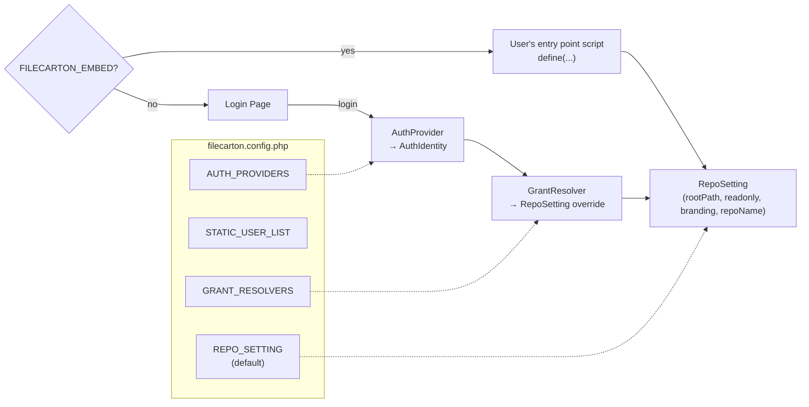

# Configuring authentication

> If you're new here you should start with [getting_started.md](getting_started.md) for a minimal working setup.
> If you want to embed FileCarton in your own app, please see [embedding.md](embedding.md) instead.
> If you want to write a custom auth plugin, please see [auth_provider.md](auth_provider.md).

FileCarton has a built-in auth system supporting password or OAuth login.



- **Auth providers** handle password or OAuth login, and produce an `AuthIdentity` (a user ID + display name).
- **Grant resolvers** map `AuthIdentity` to a `RepoSetting` override (which directory to show, read-only or not, etc.). The override is combined with the default `FILECARTON_REPO_SETTING` from the config.
  The built-in `StaticGrantResolver` looks up the user's ID in `STATIC_USER_LIST`.
- **`STATIC_USER_LIST`** is the user table used by built-in authentication plugins (`StaticPasswordAuth`, `NoLoginAuth` and `StaticGrantResolver`).
- If you are to embed FileCarton in your own application, you're likely already handling authentication in other parts of your app. In which case you should see [embedding.md](embedding.md) instead.

## How do I configure FileCarton to use...

### Password login

Use `StaticPasswordAuth` and add a `passwordHash` to your user rows:

```php
define_default('FILECARTON_STATIC_USER_LIST', [
    [
        'id'           => 'admin',
        'displayName'  => 'Admin', // (Optional)
        'passwordHash' => '$2y$10$...your.bcrypt.hash.here...',
        'root'         => __DIR__ . '/folder-for-admin', // (Optional, sets the user's root directory)
    ],
]);

define_default('FILECARTON_AUTH_PROVIDERS', [
    ['class' => \FileCarton\StaticPasswordAuth::class],
]);
```

Generate a password hash from the command line:

```bash
php -r "echo password_hash('your-password', PASSWORD_DEFAULT), PHP_EOL;"
```

Paste the output as the `passwordHash` value. Do not store the plaintext password anywhere.

### OAuth (Github as example)

You can add GitHub login alongside or instead of passwords:

```php
define_default('FILECARTON_STATIC_USER_LIST', [
    ['id' => 'admin', 'passwordHash' => '$2y$10$...'], // Password user
    ['id' => 'github:583231'],  // GitHub user
]);

define_default('FILECARTON_AUTH_PROVIDERS', [
    ['class' => \FileCarton\StaticPasswordAuth::class],
    ['class' => \FileCarton\GitHubOAuth::class, 'clientId' => 'Ov23li...', 'clientSecret' => '...'],
]);
```

The following OAuth providers are built in:

| Class | User ID format | Notes |
|---|---|---|
| `GitHubOAuth` | `github:<numeric id>` | Find the numeric ID at `https://api.github.com/users/<username>` (the `id` field). |
| `MicrosoftOAuth` | `microsoft:<object id>` | Accepts any Microsoft account by default. Pass `'tenant' => 'consumers'` for personal accounts only, or a specific tenant ID for a single org. |
| `GoogleOAuth` | `google:<sub>` | The `sub` is a stable numeric string from Google's OpenID Connect. Find it at the OAuth consent screen or via the userinfo endpoint. |
| `DiscordOAuth` | `discord:<snowflake id>` | The snowflake is the user's numeric ID visible in Discord developer mode. |

- All providers accept `clientId` and `clientSecret` in the config array.
- You'll need to create an OAuth app on the provider's website and get the client ID and client secret.  
  **NOTE:** The redirect URL should be set as `http(s)://.../...php`**`?fcauth=callback`**!
- You'll need to whitelist users by adding them to `FILECARTON_STATIC_USER_LIST` with the provider-prefixed ID (see the table above).
  If the user's ID does not match any row in `FILECARTON_STATIC_USER_LIST`, the user will see "This account is not allowed to log in" along with their account ID (e.g. `github:583231`), which they can forward to the administrator for whitelisting.

If you want to automatically allow all users from a certain OAuth provider to be granted access, you should write your custom `GrantResolver`. By doing so you can also do fancy things like automatically assigning users their own folder.

If your server is behind a reverse proxy, set `FILECARTON_PUBLIC_ORIGIN` so the OAuth redirect URL is correct:

```php
define_default('FILECARTON_PUBLIC_ORIGIN', 'https://files.example.com');
```

### Open access

Anyone can access files without logging in. You need one entry in `FILECARTON_STATIC_USER_LIST` as the default identity.

```php
define_default('FILECARTON_STATIC_USER_LIST', [
    ['id' => 'local'],
]);
define_default('FILECARTON_AUTH_PROVIDERS', [
    ['class' => \FileCarton\NoLoginAuth::class],
]);
```

### Link buttons (e.g. registration)

You can add buttons to the login page that link to an external URL (such as a registration page) without performing authentication. The user is redirected to the URL with a return parameter, so the external site can send them back when done.

```php
define_default('FILECARTON_AUTH_PROVIDERS', [
    ['class' => \FileCarton\StaticPasswordAuth::class],
    [
        'class'       => \FileCarton\LinkAuth::class,
        'id'          => 'register',
        'url'         => 'https://example.com/register',
        'label'       => ['key' => 'auth.register'],
        'icon'        => '',
        'returnParam' => 'redirect_uri',
    ],
]);
```

| Option | Default | What it does |
|---|---|---|
| `id` | *(required)* | A unique ID for this button. Must match `[a-z][a-z0-9_]{0,31}`. |
| `url` | *(required)* | The URL to redirect to. Must start with `https://` or `http://`. |
| `label` | `''` | Button text. See [Label formats](#label-formats) below. |
| `icon` | `''` | Button icon, same format as OAuth providers. See [auth_provider.md](auth_provider.md#provider-icons). |
| `returnParam` | `'redirect_uri'` | Name of the query parameter appended to `url` containing the return URL. The external site should redirect the user to this URL when finished. |

`LinkAuth` buttons appear alongside OAuth buttons on the login page. They do not authenticate the user and cannot be the only provider.

### Label formats

All redirect providers (OAuth and `LinkAuth`) support structured labels. The `label()` return value controls the button text:

| Format | Example | Result |
|---|---|---|
| String | `'Register'` | Displayed as-is. |
| i18n key | `['key' => 'auth.register']` | Resolved via the frontend's locale files. |
| i18n key + params | `['key' => 'auth.oauth_continue', 'params' => ['service' => 'GitHub']]` | "Continue with GitHub" (localized). |
| Per-language | `['langs' => ['en' => 'Sign up', 'zh' => '注册']]` | Picked by the user's locale. |

The per-language format also accepts an optional `params` key for `{placeholder}` interpolation.

Built-in OAuth providers use the `auth.oauth_continue` key by default, so their button text is localizable.

## The user list

Each row in `FILECARTON_STATIC_USER_LIST` is an array with these fields:

| Field | Required | What it does |
|---|---|---|
| `id` | yes | The username for password login (must not contain `:`), or the provider-prefixed ID for OAuth (e.g. `github:583231`, `google:1234567890`). Also used by `StaticGrantResolver` to look up grants. |
| `passwordHash` | no | A `password_hash()` output. If present, `StaticPasswordAuth` will accept this user with the matching password. |
| `displayName` | no | Shown in the toolbar. Defaults to `id`. |
| `root` | no | Overrides the default `rootPath` in `FILECARTON_REPO_SETTING` for this user. Use an absolute path. |
| `readonly` | no | `true` forces read-only for this user; `false` forces writable even if the default is read-only. Though when `FILECARTON_MUST_READONLY` is `true` the instance is always read-only. |
| `branding` | no | Overrides the default `branding` in `FILECARTON_REPO_SETTING` for this user. An empty string `''` hides the branding. |
| `repoName` | no | Overrides the default `repoName` in `FILECARTON_REPO_SETTING` for this user. |

Example with per-user directories:

```php
define_default('FILECARTON_STATIC_USER_LIST', [
    ['id' => 'alice', 'passwordHash' => '$2y$10$...', 'root' => '/srv/files/alice'],
    ['id' => 'bob',   'passwordHash' => '$2y$10$...', 'root' => '/srv/files/bob', 'readonly' => true],
    ['id' => 'github:583231', 'displayName' => 'octocat', 'root' => '/srv/files/shared'], 
]);
```

## Grant resolvers

The default `StaticGrantResolver` looks up the logged-in user's ID in `STATIC_USER_LIST` (case-insensitive) and returns any `root`/`readonly`/`branding`/`repoName` overrides it finds as a `RepoSetting`. These overrides are combined with the default `FILECARTON_REPO_SETTING` — non-null fields from the grant replace the default values.

If the static list does not fit your needs (for example, you want to look up user directories from a database), you can write a custom grant resolver. See [auth_provider.md](auth_provider.md) for how to do that.

The `FILECARTON_GRANT_RESOLVERS` array is evaluated in a chain, where each resolver can either return a `RepoSetting` or pass. The first non-null result is used and combined with the default `FILECARTON_REPO_SETTING`. If no resolver returns anything, the user is denied access.

```php
define_default('FILECARTON_GRANT_RESOLVERS', [
    ['file' => __DIR__ . '/my_resolver.php', 'class' => \MyApp\DbGrantResolver::class, 'dsn' => '...'],
    ['class' => \FileCarton\StaticGrantResolver::class],  // If you want fallback
]);
```

## Mixing providers

You can combine password and redirect providers. The login page will show a form for passwords (which is checked against every password auth provider) and a button for each redirect provider.

`NoLoginAuth` will just skip the login page and thus cannot be combined with other providers.

## Deployment

For production deployments you should **always use HTTPS.**

- If TLS is terminated at a reverse proxy, configure the proxy to send `X-Forwarded-Proto: https` so that FileCarton generates correct OAuth callback URLs.
- Or if that doesn't work, you can set `FILECARTON_PUBLIC_ORIGIN` to your public origin URL (with scheme, without path).

## Session

FileCarton stores login state in the standard PHP session. In standalone mode, the session cookie is named `FILECARTON` by default. When embedding, FileCarton uses the host application's existing session.

## See also

- [getting_started.md](getting_started.md): Quick setup for standalone or embedded deployment.
- [auth_provider.md](auth_provider.md): Writing custom auth providers and grant resolvers.
- [embedding.md](embedding.md): Embedding FileCarton in your existing PHP application.
